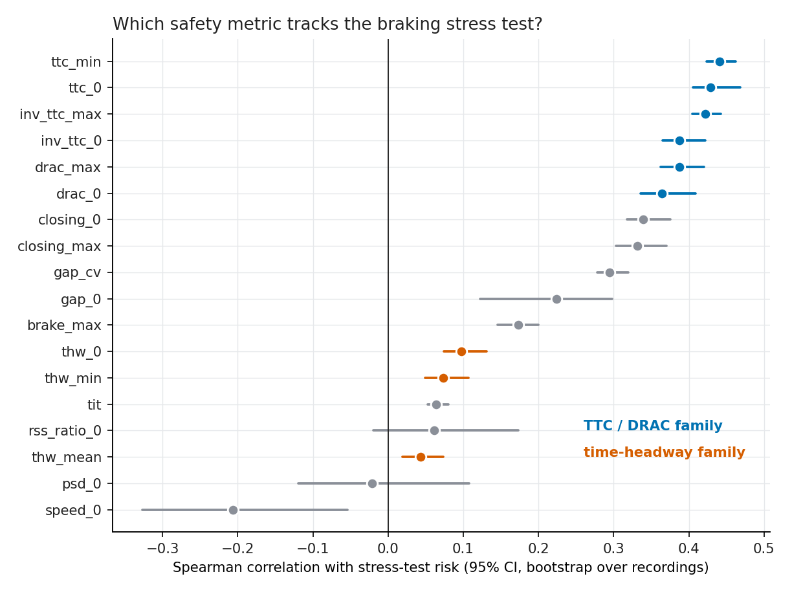
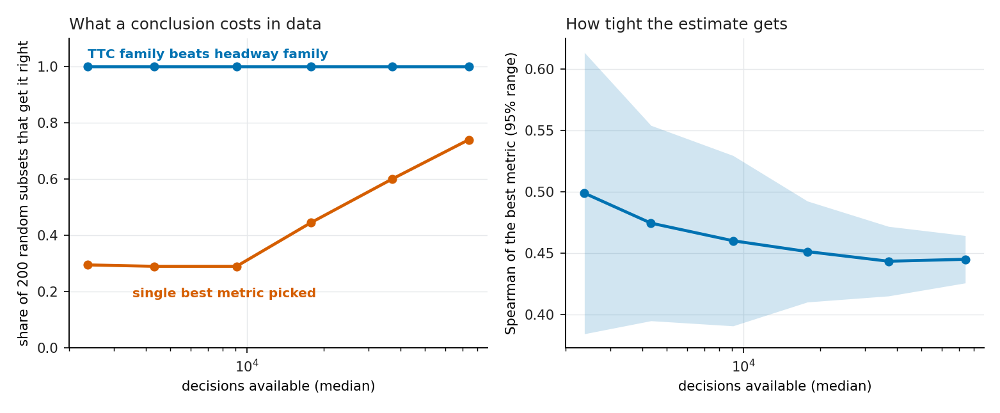
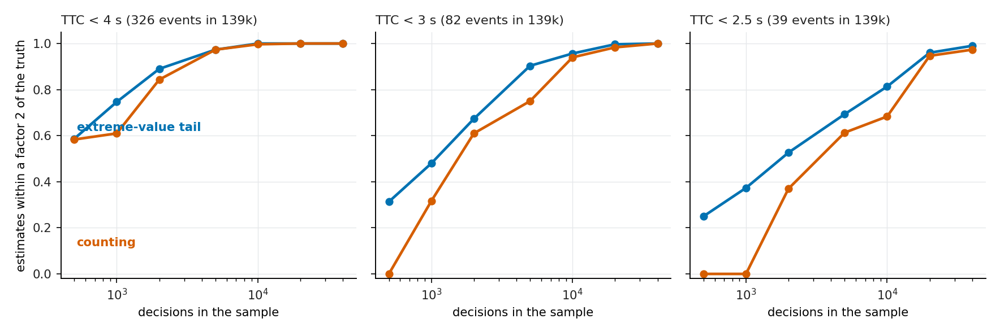
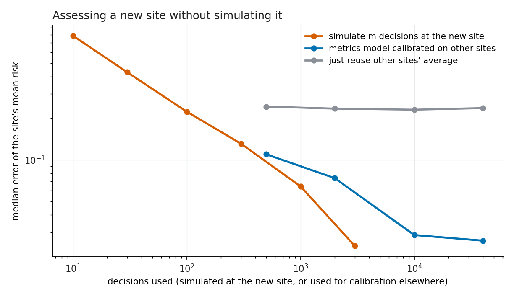

# risk-predictors

**How much data does a traffic-safety metric need before you can trust it?** I tested 18 surrogate safety measures (time to collision, time headway, braking demand and others) on 139,410 real car-following situations from the highD drone dataset, scored each against a braking stress test of a cruise-control and emergency-braking system, and measured how much data it takes to reach a conclusion, to estimate rare close calls, and to assess a new road without simulating it.

## What I did

- **Data.** highD: 60 drone recordings of German highways at 25 Hz, six locations, 79,830 passenger-car followers. I cut every following episode into non-overlapping 5 s windows; the end of the window is the decision time. That gives **139,410 decisions**. My bumper-to-bumper gap, rebuilt from positions, matches the dataset's own `dhw` column to within 0.01 m.
- **Stress test (the "risk" label).** From the real gap and speeds at the decision time, the lead vehicle brakes (3, 5 or 7 m/s² for 1 or 2 s) and the following car is replaced by a system under test: a constant time-gap cruise control (ACC) plus an automatic emergency brake (AEB) that reacts to its own delayed, noisy time-to-collision measurement. 48 system settings (AEB trigger, sensor delay, brake strength, braking severity). A decision's **risk** is the share of the 48 stress cases that end in contact. 15.3% of decisions have risk above 0; 253 have risk of at least 0.25.
- **Predictors.** 18 metrics computed only from the window up to the decision time (an automated test checks nothing from after it is used): 9 at the decision instant and 9 summarising the 5 s before it.
- **Questions.** (1) Which metric tracks the stress test, with bootstrap intervals that resample whole recordings. (2) Does a combined model or the 5 s history beat the best single metric. (3) How many recordings does it take to find the best metric. (4) How many decisions does it take to estimate the frequency of rare close calls, by counting or by an extreme-value (generalised Pareto) tail. (5) Can metrics calibrated on other sites replace simulation at a new site.

## Results

**1. Time-to-collision metrics track the stress test; time headway does not.**



| metric | Spearman with risk (95% CI) | AUROC, any contact | AUROC, risk >= 0.25 |
|---|---|---|---|
| minimum TTC in the window | **0.44** (0.42 to 0.46) | 0.82 | 0.98 |
| maximum inverse TTC in the window | 0.42 (0.40 to 0.44) | 0.83 | 0.98 |
| DRAC (required braking) at the decision | 0.36 (0.34 to 0.41) | 0.77 | **0.997** |
| time headway at the decision | 0.10 (0.07 to 0.13) | 0.57 | 0.50 |
| mean time headway in the window | 0.04 (0.02 to 0.07) | 0.53 | 0.37 |

Time headway is what most following-distance functions are tuned on, yet it ranks well below TTC and DRAC here. For the 253 most dangerous decisions DRAC separates them from the rest almost perfectly (AUROC 0.997).

**2. A combined model is near-perfect; the 5 s of history adds no information beyond the current state.** Gradient boosting on the 9 instant metrics reaches AUROC 0.999 for "any contact" (recording-grouped 5-fold cross-validation), against 0.835 for the best single metric. The 9 window metrics alone reach 0.981. Together they reach 0.999, no better than the instant metrics. This is expected, since the stress outcome is a function of the current state, and it means the single named metrics lose information rather than the data being noisy.

**3. The family of the best metric is clear from one recording; the single best metric is not clear from 32.**



TTC-family metrics beat headway-family metrics in 100% of 200 random subsets even with one recording (about 2,400 decisions). Picking the single best metric is much harder because the top three are within 0.02 of each other: it is picked correctly in 30% of subsets at 1 to 4 recordings, 60% at 16 recordings, 74% at 32 recordings (about 74,000 decisions). The width of the 95% range of the best metric's Spearman correlation shrinks from 0.23 (1 recording) to 0.04 (32 recordings).

**4. A tail model reaches the right order of magnitude with less data than counting.** The target is the share of decisions whose window contains a time to collision below a threshold; the truth is taken from all 139,410 decisions.



| event | events in 139k | sample size | counting within 2x of truth | tail model within 2x |
|---|---|---|---|---|
| TTC < 3.0 s | 82 | 1,000 | 32% (55% see zero events) | **48%** |
| TTC < 3.0 s | 82 | 5,000 | 75% | **90%** |
| TTC < 2.5 s | 39 | 2,000 | 37% (53% see zero events) | **53%** |
| TTC < 2.5 s | 39 | 10,000 | 68% | **81%** |

Both reach 95% or better by 20,000 decisions. The tail model tends to underestimate (median ratio to truth 0.57 to 0.9 below 5,000 decisions).

**5. Metrics calibrated on other sites can stand in for simulating a new site.** Leave one location out: a gradient-boosting model of risk on the 9 instant metrics, calibrated on decisions from the other five locations and applied to every decision of the new location, estimates the site's mean risk with a median error of **2.9% from 10,000 calibration decisions**. Simulating the new site's own decisions reaches the same 2.4% only at 3,000 decisions (13% at 300, 22% at 100). A single-metric isotonic calibration on minimum TTC plateaus at about 10% error.



## How it was built

```
highD CSV -> ingest (gap check, 5 s windows) -> predictors (18, causal)
          -> stress test (48 ACC+AEB settings, vectorised) -> risk per decision
          -> analysis (ranking, history, data size) / evt / transfer -> figures
```

- Every parameter is in `configs/default.toml`; nothing is hard-coded in `src/`.
- 10 automated tests: stress-test physics (large gap never crashes, harder lead braking never helps, contact needs closing speed, determinism) and predictor definitions (known values, no use of information after the decision time).
- A first version of the stress test (lead braking to a full stop) crashed almost every decision at 36% to 90% for several settings, because no ACC+AEB system can avoid a stopped car from 30 m/s at that gap. I replaced it with finite braking events and made the cruise control hold its own speed, which is why the risk label spreads over decisions.

Reproduce:

```bash
pip install -e .[dev]
python -m riskpred.ingest        # about 1 min
python -m riskpred.stress        # about 4 min
python -m riskpred.cli analyze   # about 40 min (mostly the site-transfer study)
python -m riskpred.figures
pytest
```

## Limits

- The risk label comes from a **simulated** system under test and a **synthetic** lead-braking event applied to real traffic states; highD contains no crashes, so none of this validates a metric against real crashes. It tells you how well each metric tracks a defined stress test.
- Because the stress outcome is determined by the state, the combined model's 0.999 mostly shows that it can learn the simulator; it is not evidence about real-world risk.
- The "best single metric" in section 2 is chosen on all data, not inside each fold.
- The tail study draws random decisions, ignoring dependence between decisions of the same recording, and its truth is itself an empirical frequency from 82 and 39 events.
- Only passenger-car followers on German highways; location 1 supplies 115,909 of the 139,410 decisions, location 5 has 11,677, and the other four have between 2,594 and 3,487 each.

## Tech stack
Python, NumPy, pandas, SciPy, scikit-learn (gradient boosting, isotonic calibration), pyarrow, matplotlib, pytest.

## Data and credits
The highD dataset is **not redistributed here**. It is described in [arXiv:1810.05642](https://arxiv.org/abs/1810.05642) and available from [highd-dataset.com](https://www.highd-dataset.com/) under its own terms of use. Download it, put the recording csv files under `data/highd`, and run the steps above. This repository contains only code and aggregate results and figures derived from the data, no per-vehicle data.
